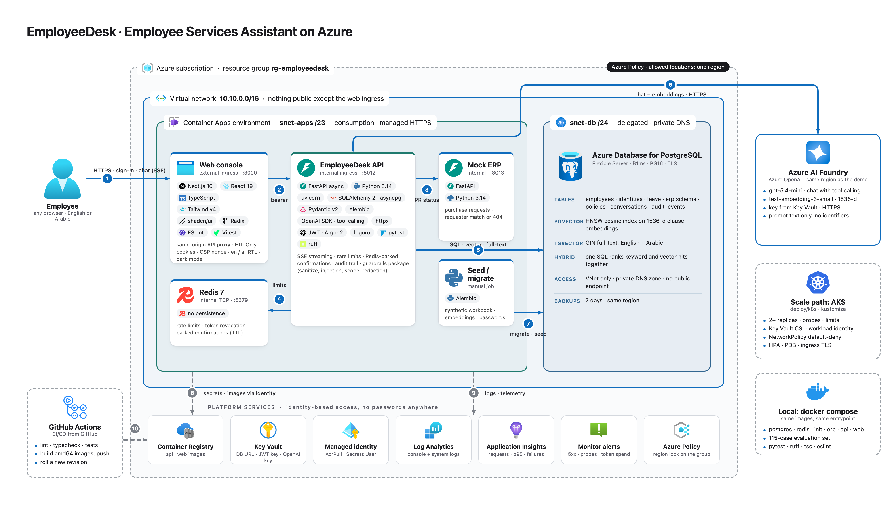

# Architecture

## Deployment topology

- Only the web console is public. The API, the mock ERP and Redis sit behind internal ingress; PostgreSQL has no public endpoint.
- Secrets live in Key Vault and reach the apps through a managed identity. No password in an image, a manifest or a config file.
- The same images run locally with docker compose and on Kubernetes with the manifests in `deploy/k8s`.

## One assistant turn

The guardrails the tools and the confirmation gate are on their own page: [docs/AI_ARCHITECTURE.md](docs/AI_ARCHITECTURE.md).

## Code layout

Four layers per module (`router / service / schemas / repository`) under `src/app/modules`, async end to end. See the README for the tree.
