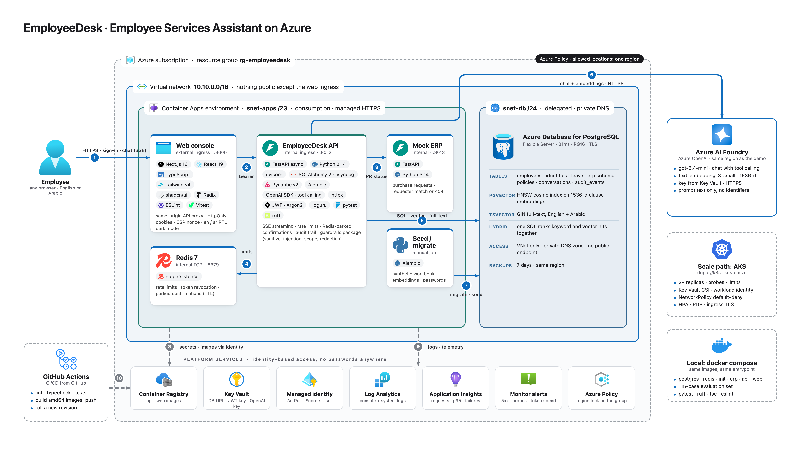

# EmployeeDesk-Backend

Bilingual (English / Arabic) employee services assistant: HR and procurement policy answers with citations, leave balances and requests, purchase request status through a mock ERP. FastAPI (async) + PostgreSQL (pgvector) + Redis. Package manager: PDM.

All data is synthetic. Nothing here comes from any real organisation.



Architecture note: [ARCHITECTURE.md](ARCHITECTURE.md). How one assistant turn works: [docs/AI_ARCHITECTURE.md](docs/AI_ARCHITECTURE.md).

## Run locally

```bash
cp .env.sample .env
docker compose up -d postgres redis      # Postgres on 127.0.0.1:5433, Redis on 6380
pdm install
pdm run migrate                          # alembic upgrade head
pdm run seed                             # load seed/*.xlsx (idempotent)
pdm run set-password --all Synthetic-Pass-1
pdm run mock-erp                         # http://localhost:8013/docs (separate terminal)
pdm run dev                              # http://localhost:8012/docs
```

Azure OpenAI: set `AZURE_OPENAI_BASE_URL` (resource-level `/openai/v1`), `AZURE_OPENAI_API_KEY`, `AZURE_OPENAI_CHAT_DEPLOYMENT`, `AZURE_OPENAI_EMBEDDING_DEPLOYMENT` in `.env`, then `pdm run seed` again to embed the policy clauses. Without them the API runs with keyword-only policy search and no assistant.

Sign in with any active synthetic employee, e.g. `user001@example.test` / `Synthetic-Pass-1` (E1001). E1070, E1075 and E1080 are inactive and are refused.

## Check

```bash
pdm run lint      # ruff
pdm run test                       # pytest, scripted model, against the local compose stack
EMPLOYEEDESK_LIVE=1 pdm run test tests/test_assistant_live.py   # real model, costs tokens

# evaluation set (115 cases, real model; needs api with RATE_LIMITING=false and mock-erp running)
pdm run test-set && pdm run test-report   # -> docs/TEST_RESULTS.md
```

## Layout

```
src/app/
  main.py               app, middleware, exception handlers
  api/                  router wiring, auth dependencies (who is calling)
  core/                 config, exceptions, middleware, rate limiter, redis
  database/             engine, session, enums, models (SQLAlchemy)
  modules/<name>/       router / service / schemas / repository per feature
src/mock_erp/           the mock ERP service (separate process)
migrations/             alembic
scripts/                seed, password, test-set runner
seed/                   the synthetic workbook
deploy/                 k8s manifests, Azure note
tests/                  pytest + the evaluation set
```

## Status

| Step | State |
|---|---|
| Database schema + seed | done |
| Core + auth + employees (`/auth/*`, `/employees/me`, `/health/*`) | done |
| Leave (`/leave/balances`, `/leave/requests`), procurement (`/procurement/requests`), policies (`/policies`, `/policies/search`) | done |
| Mock ERP service (`src/mock_erp`, port 8013) | done |
| Assistant (`/assistant/chat`, `/assistant/chat/stream`, `/assistant/confirm/{id}`, conversations, `/audit/me`) | done |
| Test set runner + results (`pdm run test-set`, `pdm run test-report`, `docs/TEST_RESULTS.md`) | done |
| Dockerfile, k8s manifests (`deploy/k8s`), Azure note (`deploy/azure`) | done |

## CI/CD

`ci.yml` runs ruff, migrations, the seed and pytest against Postgres + Redis service containers on every push and pull request, and builds the image without pushing. `deploy.yml` runs after a green CI on `main`: it builds the images in Azure Container Registry, runs the seed job for migrations, rolls new revisions of the mock ERP and the API and smoke-tests the console. It signs in to Azure with OIDC; the repository needs the secrets `AZURE_CLIENT_ID`, `AZURE_TENANT_ID`, `AZURE_SUBSCRIPTION_ID` and the variables `AZURE_RESOURCE_GROUP`, `AZURE_ACR_NAME`.
