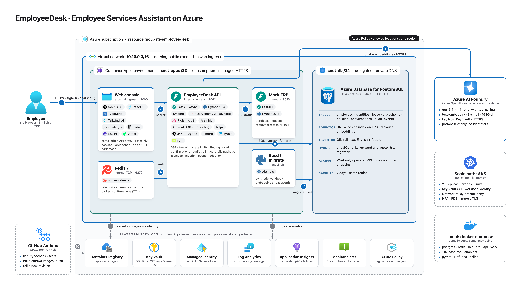

# Azure deployment approach

## Approach

Everything lives in one resource group with a region lock. The web console and the API run as Azure Container Apps inside a VNet together with the mock ERP and Redis. Only the web console is reachable from the internet. The other three use internal ingress. PostgreSQL Flexible Server with pgvector sits in its own delegated subnet behind a private DNS zone and has no public endpoint. Images are built in Azure Container Registry and pulled with a managed identity. The same identity is the only thing allowed to read Key Vault. Apps get their secrets as Key Vault references so nothing sensitive is baked into an image or a manifest. A one-off Container Apps job runs the migrations and loads the synthetic workbook. Azure OpenAI is called over HTTPS with prompt text only. The Kubernetes manifests in `deploy/k8s` are the AKS path and reuse the same images and the same probes.

## Monitoring

Today every app streams console and system logs to Log Analytics. Azure Monitor keeps the platform metrics for the apps and the database. Each app has startup liveness and readiness probes. The assistant writes an audit event for every step so refusals and injection attempts show up on the Activity page. What is defined but not switched on in the demo is Application Insights telemetry from the API through OpenTelemetry together with a token spend counter per turn and a set of alert rules for 5xx rate failing readiness replica restarts database pressure and token budget. These feed an action group by e-mail. A single workbook would put traffic errors latency and guardrail counters on one page. See [monitoring.png](../../docs/diagrams/monitoring.png).

## Qatar data residency

The design targets Qatar Central. A resource group policy only allows that region. Backups and logs stay in region and the database is never public. Qatar Central does not yet offer Container Apps or Azure Cache for Redis for this subscription and PostgreSQL Flexible Server needs a capacity request there. The demo therefore runs in UAE North which is the closest region with the full set. It uses the same template with the policy pinned to `uaenorth`. Moving to Qatar Central means changing the policy parameter and the region flag. Nothing in the code or the manifests is tied to a region. The only call that would leave Qatar Central in production is the Azure OpenAI endpoint. It receives prompt text only and never an employee identifier. The key stays in Key Vault.
