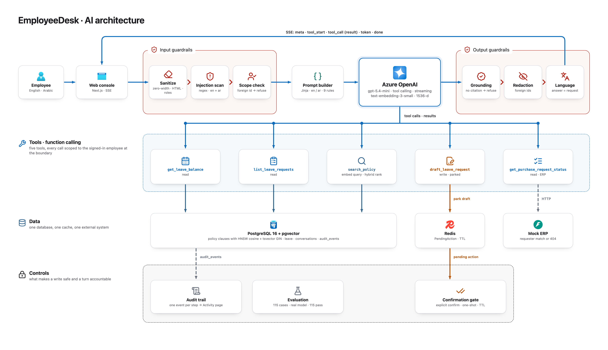

# AI architecture

A turn starts with the input guardrails. The text is cleaned of hidden characters and role markers and checked against injection patterns in English and Arabic. If it names another employee it is refused before the model is called. The prompt builder then renders the system prompt from a Jinja template in the language of the request and adds the employee facts from the session and the conversation history. Azure OpenAI answers with tool calling and streams tokens back over SSE.

Five tools are available. Three read leave balances leave requests and policy clauses from PostgreSQL. One reads purchase request status from the mock ERP. One drafts a leave request and parks it in Redis with a TTL. Every tool is scoped to the signed-in employee at the boundary so the model cannot reach another record even if asked to. Policy search embeds the question and ranks vector and keyword hits in one SQL query.

Output guardrails run after the last token. An answer about policy without a citation becomes a refusal. Foreign identifiers are redacted and the answer language is checked against the request. A parked draft is only written after an explicit confirm call from the console. Every step writes an audit event that the Activity page reads back. The evaluation set of 115 cases runs against the real model and all of them pass.
